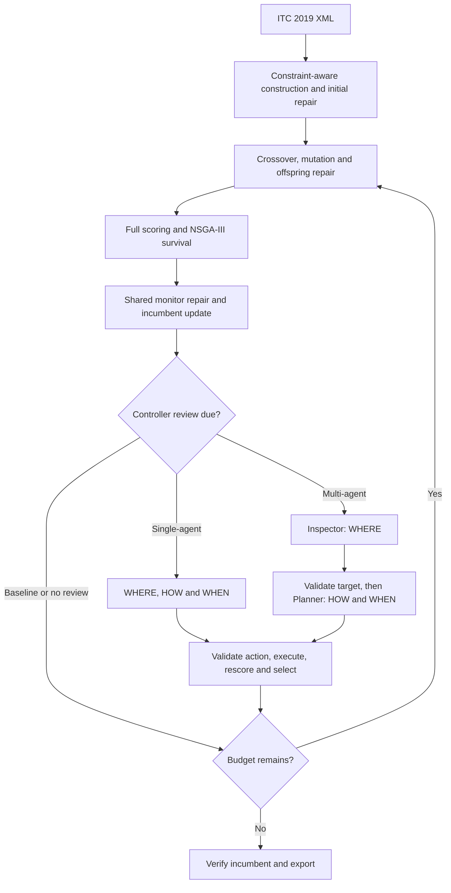

# Pipeline reference

This document describes the shared solver and controller contracts. Setup, profiles and saved report locations are listed in the [repository README](README.md).

## Representation and scoring

Each ITC 2019 XML is an independent problem. A chromosome has `2n` entries: time-option indices followed by room-option indices for the `n` classes. Classes that do not require a room use `-1`. Student assignment is computed by the scorer rather than encoded in the chromosome.

NSGA-III minimizes four weighted objectives: time, room, soft distribution and student conflict. Hard violations are handled separately:

```text
hard = room_conflicts + room_unavailable
     + hard_distributions + unassigned_requests
```

Student sectioning starts with greedy bundle assignment. When requests remain unassigned, bounded bundle enumeration and CP-SAT reallocate course capacity across its enrolled students. Sectioning uses class limits. The fallback prioritizes capacity feasibility and does not guarantee minimum student-conflict cost.

The incumbent is the best fully scored candidate under `(hard, total weighted penalty)`. It is stored independently of population survival, so a good candidate remains available for final output even if NSGA-III removes it from the population. This stores one representative solution, not a complete external Pareto archive.

Source: [instance.py](NSGA-III/itc2019/instance.py), [scoring.py](NSGA-III/itc2019/scoring.py), [sectioning.py](NSGA-III/itc2019/sectioning.py).

## Shared solver

All three pipelines use the same construction, NSGA-III operators, scorer, monitor repair and incumbent. The baseline includes these repairs.



Construction orders constrained classes first and propagates compatible choices. Initial and offspring repair use bounded single-class and joint two-class moves. Variation preserves inherited placements instead of rebuilding the schedule.

The shared monitor adds the following repair routes:

| Route | Purpose |
| --- | --- |
| Distribution-group CP | Jointly repair required distribution violations with classes outside the region fixed |
| Room plateau search | Cross temporary neutral or worse states to reduce the final hard count |
| Adaptive room CP | Expand the neighborhood around remaining room conflicts near feasibility |
| Beam fallback and backoff | Bound unsuccessful repair work and defer repeated attempts |

CP neighborhoods model room clashes, unavailable rooms, required pairs, MaxDays, MaxDayLoad, MaxBreaks and MaxBlock, including fixed outside classes. Candidates are checked by the full scorer before acceptance. A bounded or sampled neighborhood that finds no candidate does not establish infeasibility of the full problem.

The default search continues after internal feasibility to improve soft cost. The direct CLI option `--stop-on-feasible` instead stops after a completed generation containing a feasible candidate.

Source: [construction.py](NSGA-III/itc2019/construction.py), [nsga3.py](NSGA-III/itc2019/nsga3.py), [neighborhood.py](NSGA-III/itc2019/neighborhood.py), [shared monitor](NSGA-III/itc2019/controller.py).

## Controller contract

The shared read-only extractor builds StatePacket v2. The six model-facing blocks are:

| Block | Contents |
| --- | --- |
| `global_search_state` | Progress/evaluations, population and feasible counts, separate population-best/incumbent/best-feasible quality, weighted objective distributions and diversity |
| `recent_quality` | Generation-labelled incumbent history, hard/feasible-total stagnation mode and review triggers |
| `candidate_regions` | Published target IDs, active placements/domains, heuristic nonadditive contributions, operator eligibility and local diagnostics |
| `boundary_context` | Fixed outside placements, complete validation-ID registry, bounded rule descriptions and their current satisfaction/cost |
| `recent_outcomes` | Requested action/budget, actual work, source/best-trial/candidate quality, admission/selection and incumbent changes |
| `action_limits` | Global operator list and bounded execution/review allowances; `no_op` uses null targets and zero execution budget |

Schema version, instance/seed identity, packet/settings hashes, source fingerprints and diagnostic time/work are trace metadata rather than model payload. Target/boundary IDs identify the published source snapshot. Both controllers use the same extractor; Planner receives that packet plus Inspector's validated diagnosis.

Diagnostics exhaust small one-gene pools or deterministically sample at most 24 alternatives per active class. Per region, return at most 32 outside placements, 12 rule descriptions and two placement examples. Full distribution groups are checked before display truncation. Swap-domain compatibility is distinct from local conflict checks; joint CP is not run to predict a repair outcome. Counts, coverage and truncation are explicit. Negative deltas mean improvement, but passing a local check does not guarantee a better full score or complete student resectioning. Unknown values remain null and student identities never enter the payload.

Extraction makes zero full-score requests and consumes no solver RNG. Student-conflict attribution uses existing cached assignments only; uncached attendance effects remain unlocalized. Optional examples are trimmed first for input size, followed by lower-ranked regions; an essential-context overflow skips the review with a recorded reason. The existing API input cap is retained, including room for the Planner envelope. A previous review with a different source is noncomparable; matching source alone remains inconclusive until scope/settings/budget also match.

Reviews start after warm-up and are triggered by a scheduled checkpoint, stagnation or low diversity. Minimum spacing and event rearming prevent repeated calls for the same stagnation or diversity episode. The controller chooses the next interval within configured bounds; progress is measured by hard violations until feasibility and by weighted total afterward.

Single-agent returns WHERE, HOW and WHEN in one response. In the multi-agent pipeline, Inspector selects WHERE; the code validates the target before Planner receives the original packet and diagnosis to select HOW and WHEN. Both methods use the same regions, operators and action limits.

| Action | Effect |
| --- | --- |
| `move` | Change a class's time or room within its domain |
| `swap` | Exchange two compatible placements |
| `destroy_repair` | Jointly repair the selected region with the outside fixed, then try a bounded fallback |
| `guided_move` | Try distinct screened one-time/room changes in ranked order, with every other placement fixed |
| `distribution_repair` | Require progress on one deterministically selected violated required rule; only relevant movable participants inside the published region may change |
| `blocker_chain` | Opt-in bounded beam through neutral/worse intermediate states within a separately published expanded region |
| `no_op` | Leave the timetable unchanged and set the next review interval |

IDs, boundary, operator, execution budget and review interval are validated before execution. An infeasible source requires a strict reduction in total hard violations. A feasible source requires hard zero and a lower weighted total. The candidate is fully rescored and submitted to selection; the incumbent also observes scored candidates.

`guided_move` reuses the private diagnostic shortlist only while its full source fingerprint matches. Its ranking uses checked hard deltas before feasibility, then known time/room costs; after feasibility known soft changes take priority. `distribution_repair` chooses the required rule by violation units, smaller mutable group and stable rule ID. A class with room freedom alone cannot repair a day/time rule. The CP model includes all fixed participants and requires a reduction in the chosen rule as well as the full hard admission check.

All operator stages share the requested logical full-evaluation allowance: source scoring when uncached, trials and the final recheck, including cache hits. A trial plus recheck needs at least two available evaluations; an uncached CP source can require one more. Construction/search has a cooperative three-second local bound. Trace outcomes include the stop reason, changed classes, targeted rule, admission, survival and source/trial/candidate weighted vectors. Rechecks are already included in new `outcome.evaluations` and are not charged twice.

`blocker_chain` is disabled by default. A direct controller CLI call with `--enable-blocker-chain` may replace the lowest-ranked offered region with one separately identified expanded target, capped at `min(10, 2 * region_size)` classes. Chain search uses at most three layers, beam width two and hard slack one, charging every full-scored intermediate state. Classes outside that target remain fixed throughout execution. The final candidate must pass the same admission rule; archive retention remains independent of population survival.

Invalid responses become logged fallback no-ops. A model-selected `no_op` is recorded separately from validation failure and API failure.

Source: [controller.py](NSGA-III/itc2019/controller.py), [regions.py](NSGA-III/itc2019/regions.py), [operators.py](NSGA-III/itc2019/operators.py).

## API and budgets

Both controllers use the Gemini Developer API through [llm.py](NSGA-III/itc2019/llm.py). Credentials come from `GEMINI_API_KEY` or `GOOGLE_API_KEY`. The adapter requires Free Tier confirmation and restricts model selection to its allowlist. Model, pacing, timeout, token cap and input-size limits are configured by the selected profile and CLI.

The adapter makes one SDK attempt per request and disables automatic continuation and function calling. There is no provider or model fallback. Pacing waits and API latency consume runtime. Logs count actual requests and record prompt, output, thinking, cached and total tokens separately.

Failures during API requests, including quota, billing, configuration, network and timeout errors, end the controller run as `incomplete_api_failure`; the CLI publishes its status and exits with code 3. Startup configuration errors stop before optimization with exit code 2. Campaign-level retries are recorded as separate attempts rather than hidden requests. The comparison tool rejects incomplete API runs.

Search accounting includes routine repair, monitor repair, operator source/trial scoring and rechecks. StatePacket v2 extraction uses local checks only and reports zero full evaluations; earlier campaign traces can include charged region-scoring requests. Cache hits count as logical evaluations; physical scorer calls and cache hits are reported separately. CP search and local diagnostics consume time. Final verification calls are counted separately from the search budget. The final offspring batch shrinks to fit the remaining evaluation allowance. Unknown request usage is tracked separately, so reported native-token totals can be a lower bound.

Wall-clock limits are cooperative. An ongoing full score or sectioning operation may finish after the deadline. Reported solver runtime includes controller waiting and computation, but excludes XML parsing and output writing.

## Outputs and comparison

| Artifact | Contents |
| --- | --- |
| `run_config.json` | Solver/controller settings, XML and source hashes, dependency versions |
| `summary.json` / `result.json` | Scores, feasibility, runtime, accounting and completion status |
| `choices.npz` | Saved chromosome, including infeasible endpoints |
| `anytime_trace.jsonl` | Generation-level population and incumbent quality, saved incumbent objective vectors, diversity and cumulative stage timing |
| `controller_trace.jsonl` | v2 packet/metadata, review timestamps, role usage, validated action, source/trial/candidate outcomes and incumbent before/after |
| `solution.xml` / `expected.json` | Internally feasible schedule and score/hash for independent validation |

The run identity includes configuration, inputs, source hashes and dependencies. A repeated identity replaces prior output only after the new run has completed staging. Profiles retain their original calibration provenance and historical document labels; these records stay unchanged to preserve saved hashes.

Compare paired runs with the same instances, seed, solver/repair settings and compatible source versions. Controller comparisons also require matching model and transport policies, with equal review caps and the appropriate one-call/two-call allowances.

```cmd
python compare_pipelines.py --baseline "BASELINE_RUN_DIR" --single "SINGLE_RUN_DIR" --multi "MULTI_RUN_DIR" --output comparison.json
```

`--multi` is optional for baseline/single comparisons. Time-censored endpoints are distinguished from runs that reached equal evaluation budgets. Keep follow-up and original campaign endpoints separate when their budgets differ.

## Design decisions and limitations

- Whole XML instances are compared using paired seeds and shared per-instance profiles. The baseline receives the same underlying solver and repairs as both agent methods.
- Single versus baseline measures the complete controller package, including additional interventions. Multi versus single measures the two-call package, including its extra latency and tokens; it does not isolate role specialization alone.
- Student sectioning remains bounded and heuristic. Local CP minimizes modeled hard cost while infeasible, or weighted time/room cost in feasible soft mode; the full scorer checks the complete candidate afterward.
- Room CP is gated near feasibility, and distribution repair has its own gate. Mixed violations can remain unresolved within the allocated budget.
- The saved campaign covers two seeds. Its results describe those runs rather than establishing a general statistical advantage.
- Campaign snapshots currently store absolute paths. Existing state created at another checkout location cannot resume unchanged, even when file contents match.

Research source notes are retained for [LAOS](evidence/P005/paper-card.md), [DRAGON](evidence/P012/paper-card.md), [LLM-LNS](evidence/P002/paper-card.md) and [MOTIF](evidence/P047/paper-card.md). They motivate parts of the design; superiority of the online Inspector-Planner pipeline remains an experimental question.
